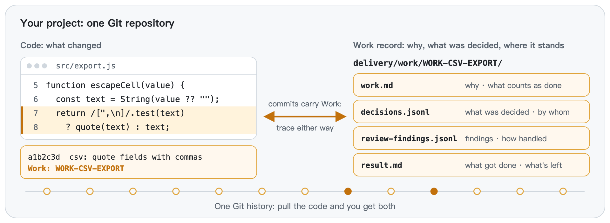
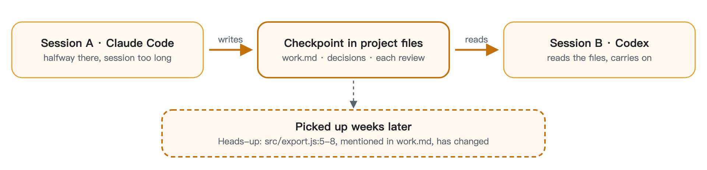
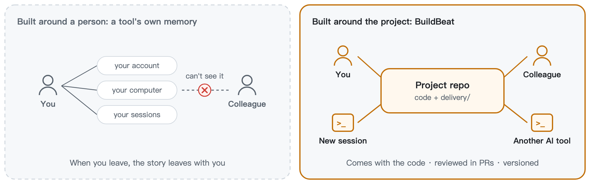
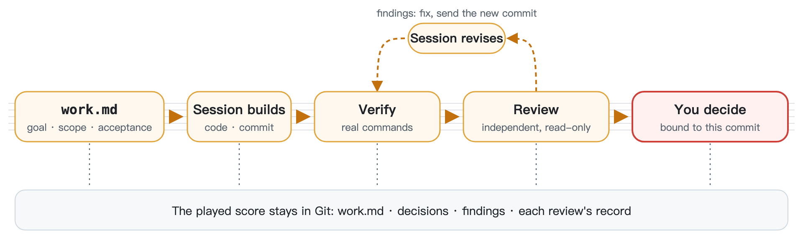
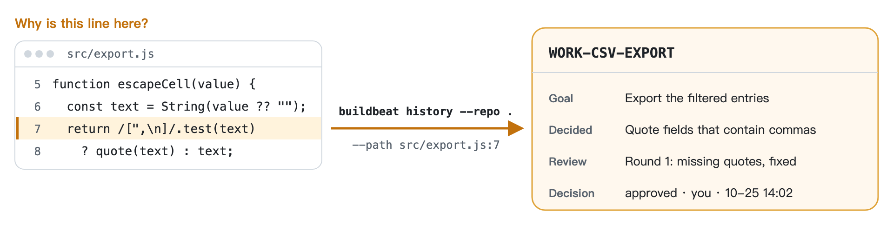
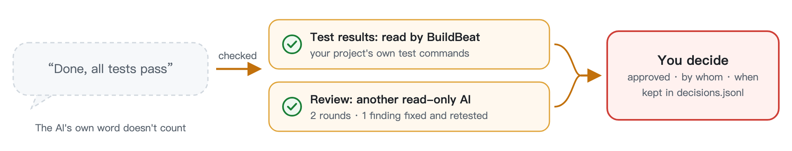

<p align="center">
  
</p>

<h1 align="center">BuildBeat</h1>

<h3 align="center">Git-based project context management</h3>
<p align="center">Why each piece of work was done, what was decided and where it stands, all kept in Git with the code,<br>so any session, tool or person can pick up where it left off.</p>

<p align="center">
  <a href="https://www.npmjs.com/package/@haiyangbg/buildbeat"></a>
  <a href="https://github.com/HaiYangBG1/BuildBeat/actions/workflows/ci.yml"></a>
  <a href="https://www.npmjs.com/package/@haiyangbg/buildbeat"></a>
  <a href="LICENSE"></a>
</p>

<p align="center"><a href="README.md">中文</a> · English</p>

When you code with AI, every switch of session, tool, computer or person means explaining everything from the start.

BuildBeat is for humans and AI sessions. It keeps the story behind each piece of work in the project and Git, so whoever picks it up can carry on.

## At a glance

<picture>
  <source media="(max-width: 600px) and (prefers-color-scheme: dark)" srcset="https://raw.githubusercontent.com/HaiYangBG1/BuildBeat/main/docs/assets/readme/context-en-dark-narrow.png">
  <source media="(max-width: 600px)" srcset="https://raw.githubusercontent.com/HaiYangBG1/BuildBeat/main/docs/assets/readme/context-en-light-narrow.png">
  <source media="(prefers-color-scheme: dark)" srcset="https://raw.githubusercontent.com/HaiYangBG1/BuildBeat/main/docs/assets/readme/context-en-dark.png">
  
</picture>

The code records what changed; the work record says why, what was decided and where it stands. Both sit in the same repository and the same Git history, and commits carry the work's ID, so you can get from either one to the other.

## What it solves

<table>
<tr>
<td>

### ① Switch sessions or tools and carry on

Long sessions make the AI forget; open a new session or switch tools and you explain it all again. BuildBeat writes each piece of work's progress and decisions into project files, so a new session reads them and carries on from where the last one stopped. Pick a piece of work up weeks later, and if code it mentions has changed, it tells you.

<picture>
  <source media="(max-width: 600px) and (prefers-color-scheme: dark)" srcset="https://raw.githubusercontent.com/HaiYangBG1/BuildBeat/main/docs/assets/readme/handoff-en-dark-narrow.png">
  <source media="(max-width: 600px)" srcset="https://raw.githubusercontent.com/HaiYangBG1/BuildBeat/main/docs/assets/readme/handoff-en-light-narrow.png">
  <source media="(prefers-color-scheme: dark)" srcset="https://raw.githubusercontent.com/HaiYangBG1/BuildBeat/main/docs/assets/readme/handoff-en-dark.png">
  
</picture>

</td>
</tr>
</table>

<table>
<tr>
<td>

### ② Context belongs to the project, not to one person

A tool's own memory is built around a person: it lives in one person's account, on one computer. A colleague taking over your module can't see it, and when you leave the project, the story leaves with you. BuildBeat is built around the project instead: context is part of the project, in the same Git repository as the code, so pulling the code brings it along; it goes through PR review with the code, keeps its version history, and any AI tool can read it.

<picture>
  <source media="(max-width: 600px) and (prefers-color-scheme: dark)" srcset="https://raw.githubusercontent.com/HaiYangBG1/BuildBeat/main/docs/assets/readme/owner-en-dark-narrow.png">
  <source media="(max-width: 600px)" srcset="https://raw.githubusercontent.com/HaiYangBG1/BuildBeat/main/docs/assets/readme/owner-en-light-narrow.png">
  <source media="(prefers-color-scheme: dark)" srcset="https://raw.githubusercontent.com/HaiYangBG1/BuildBeat/main/docs/assets/readme/owner-en-dark.png">
  
</picture>

</td>
</tr>
</table>

<table>
<tr>
<td>

### ③ The record is left behind as you work

Everyone knows requirement docs and decision logs should be written, but nobody has the time, and what does get written goes stale fast. In BuildBeat they're left behind as the work happens: the AI first writes a work.md for you to read; once you agree, decisions, test results and review findings are all recorded, and a summary is left when it's done.

<picture>
  <source media="(max-width: 600px) and (prefers-color-scheme: dark)" srcset="https://raw.githubusercontent.com/HaiYangBG1/BuildBeat/main/docs/assets/readme/loop-en-dark-narrow.png">
  <source media="(max-width: 600px)" srcset="https://raw.githubusercontent.com/HaiYangBG1/BuildBeat/main/docs/assets/readme/loop-en-light-narrow.png">
  <source media="(prefers-color-scheme: dark)" srcset="https://raw.githubusercontent.com/HaiYangBG1/BuildBeat/main/docs/assets/readme/loop-en-dark.png">
  
</picture>

</td>
</tr>
</table>

<table>
<tr>
<td>

### ④ Trace a line of code back to its work

Three months later nobody remembers why a piece of code is written the way it is, and an AI can only guess. With BuildBeat, point at that line and find which piece of work it was written for and what was decided; you can also look it up by ticket number.

<picture>
  <source media="(max-width: 600px) and (prefers-color-scheme: dark)" srcset="https://raw.githubusercontent.com/HaiYangBG1/BuildBeat/main/docs/assets/readme/trace-en-dark-narrow.png">
  <source media="(max-width: 600px)" srcset="https://raw.githubusercontent.com/HaiYangBG1/BuildBeat/main/docs/assets/readme/trace-en-light-narrow.png">
  <source media="(prefers-color-scheme: dark)" srcset="https://raw.githubusercontent.com/HaiYangBG1/BuildBeat/main/docs/assets/readme/trace-en-dark.png">
  
</picture>

</td>
</tr>
</table>

<table>
<tr>
<td>

### ⑤ Done means evidence, not the AI's word

The AI says "done, all tests pass", and you don't quite trust it, so you run and read everything again yourself. Once the AI has committed its change, BuildBeat runs the project's tests on that commit and reads the results itself, then has another read-only AI, one that did not write the code, review it. If something is found, the AI fixes it and sends the new commit. Then it stops for your decision; the approval is recorded on that commit, with who approved and when.

<picture>
  <source media="(max-width: 600px) and (prefers-color-scheme: dark)" srcset="https://raw.githubusercontent.com/HaiYangBG1/BuildBeat/main/docs/assets/readme/evidence-en-dark-narrow.png">
  <source media="(max-width: 600px)" srcset="https://raw.githubusercontent.com/HaiYangBG1/BuildBeat/main/docs/assets/readme/evidence-en-light-narrow.png">
  <source media="(prefers-color-scheme: dark)" srcset="https://raw.githubusercontent.com/HaiYangBG1/BuildBeat/main/docs/assets/readme/evidence-en-dark.png">
  
</picture>

</td>
</tr>
</table>

> Tracing code back to its work, reading test results itself and the heads-up when code changes need the runtime. Without it, letting your AI tool read the project files covers the rest; see [Skill and project files only](docs/v2/guide/12-without-runtime.en.md).

## Get started

Copy the text below into your AI coding tool (Claude Code, Codex or Cursor) and it installs and sets everything up itself:

```
Please set up BuildBeat (https://github.com/HaiYangBG1/BuildBeat) in this project:

1. Check that this machine has Node 20 or later and Git; if anything is missing, tell me how to install it.
2. Install or upgrade the BuildBeat runtime:
   npm view @haiyangbg/buildbeat@latest version
   npm install --global @haiyangbg/buildbeat@latest
   buildbeat --version
   If a version before 6 is installed and still has unfinished work, finish or cancel it with the old version before upgrading.
3. Read SKILL.md and docs/v2/guide/01-quickstart.en.md from the npm package (under $(npm root -g)/@haiyangbg/buildbeat/) and work the way SKILL.md describes from now on.
4. Following the quickstart, put the templates into this project and update .gitignore. You write the code; for the review, use another AI command-line tool already signed in on this machine by default; ask me if unsure.
5. When you're done, tell me in a sentence or two that we can start. From then on I'll just tell you in plain words what I want, and you run the commands.
```

Once it's set up, just talk to it; common situations are under "What it looks like" below.

<details>
<summary>Using Claude Code? You can also install the plugin</summary>

```text
/plugin marketplace add HaiYangBG1/BuildBeat
/plugin install buildbeat@buildbeat-plugins
/buildbeat:buildbeat
```

</details>

To install step by step yourself, see the [quickstart](docs/v2/guide/01-quickstart.en.md).

No Node or runtime? Skill and project files alone work too; see [Skill and project files only](docs/v2/guide/12-without-runtime.en.md).

## What it looks like

| Situation | Conversation |
| --- | --- |
| **First time** | **You**: (paste the text above)<br>**AI**: All set, we can start. |
| **Starting a work** | **You**: Add CSV export to the ledger.<br>**AI**: I wrote `work.md`: export the filtered entries, quote fields with commas, done when all tests pass. Look right?<br>**You**: Yes, go. |
| **New session, computer or person** | **You**: Where are we?<br>**AI**: "CSV export" is done and waiting for your go-ahead. The first review found unquoted commas; that's fixed and retested, and the second review passed.<br>**You**: Approve and merge it. |
| **One more change** | **You**: Empty lists should export too.<br>**AI**: OK, I'll commit the change, send it for testing and review again, and call you when it passes. |
| **You changed something yourself** | **You**: I reworded the button and committed it.<br>**AI**: Got it, I'll send your commit for testing and review. |
| **Stuck** | **AI**: I've stopped: the local database isn't running. That's not a code problem, so I haven't touched the code.<br>**You**: It's up, continue. |
| **Several repositories** | **You**: Where are all the repos at?<br>**AI**: Three works across two repos: one waits for your go-ahead, two are still in progress. |

It only stops to find you in these cases: a work description needs your OK, a reviewed commit waits for your go-ahead, a finding needs your ruling, or the environment is broken.

<details>
<summary>What the AI sees behind "Where are we?"</summary>

```text
$ buildbeat status --repo . --work WORK-CSV-EXPORT
WORK-CSV-EXPORT  MERGE_DECISION
  [P1 0b5e258117cb5602] (open) csv: quote fields that contain commas
  work.md ✓ · runs 2 · unadjudicated P0/P1 findings 1
  cost: review rounds 2 · findings 1
  latest RUN-CSV-EXPORT-02 WAITING_HUMAN candidate f3db37d waiting enter-wait-merge
work WORK-CSV-EXPORT:
  RUN-CSV-EXPORT-02 [final-decision] enter-wait-merge — waiting 33s
    candidate: f3db37deac08fd6f00a4891af8067c92436bd9ea
    reason: verified and reviewed with no blocking finding; the decision on this commit is the person's
    next: buildbeat decide --repo . --work WORK-CSV-EXPORT --action approve --candidate f3db37d… --by <you>
    next: buildbeat decide --repo . --work WORK-CSV-EXPORT --action reject --reason <why> --by <you>
```

</details>

## What a work is

**What**: the smallest unit BuildBeat keeps records in. One result you can see, like "CSV export", is one work, with one folder.

**Why**: the AI doesn't remember things, and sessions change at any time. What the work is for, how far it got, what review found and what you decided all go into that folder, so whoever picks it up carries on from there, and later you can look back at how it got done.

## Files in your project

The first time, the AI puts these files in place from the templates:

```
your-project/
├── AGENTS.md, CLAUDE.md            tell AI tools this project uses BuildBeat
├── .gitignore                      add the two .buildbeat/ folders below
├── delivery/                       travels with Git
│   ├── run-config.yaml             how a commit is tested and who reviews it in this project
│   ├── envelope/
│   │   ├── worker.sh               wraps the reviewing AI tool as a step BuildBeat can call
│   │   └── prompts/                the review prompt
│   └── work/
│       └── WORK-X/                 one folder per work
│           ├── work.md             what to do and what counts as done
│           ├── run-config.yaml     optional: folders this work may change, settings that differ from the project
│           ├── decisions.jsonl     accept, approve, close and other decisions
│           ├── review-findings.jsonl  problems the review found and your rulings
│           ├── releases.jsonl      checks after going live (only if used)
│           ├── result.md           written at closing: what was delivered, what is left, what went into project docs
│           └── runs/RUN-X-01/
│               └── run-record.json this review's outcome, evidence and cost
└── .buildbeat/
    ├── runtime/                    this machine only: each review's ledger, logs, screenshots
    └── worktrees/                  this machine only: the temporary checkout of a review, removed afterwards
```

- `delivery/` goes into Git: switching sessions, tools, computers or people just means pulling the code and carrying on; do not exclude it in `.gitignore` or `.git/info/exclude`. Screenshots, archives and logs under it stay on this machine, out of Git. A work's folder holds its records and the few files the work itself needs, such as its verify script. Command output, readback results and one-off scripts stay out: write the conclusions into `result.md` and keep scripts you will run again in the project's own directories. `accept` and `check` warn when more than 10 files besides the records are there.
- `.buildbeat/runtime/` and `.buildbeat/worktrees/` stay on this machine: a review still waiting for your decision does not travel with Git; on another machine, send the commit for review again
- People and AI tools without BuildBeat installed can still read these files and draft `work.md`

To contribute, see [Contributing](CONTRIBUTING.md); the code is open source under the [MIT license](LICENSE).

> **Why the name**: every step is a note, and the agent plays them beat by beat; the score it has played (context, decisions and outcomes) stays in Git, ready to read again.
