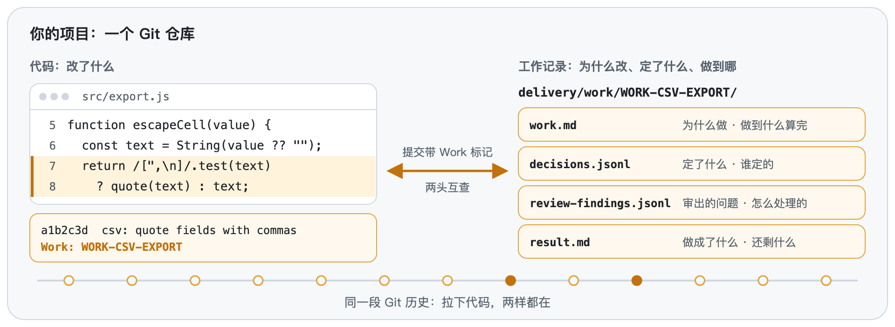
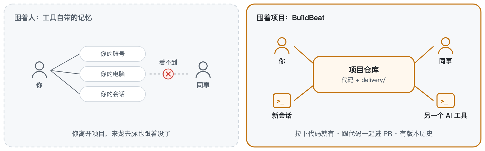
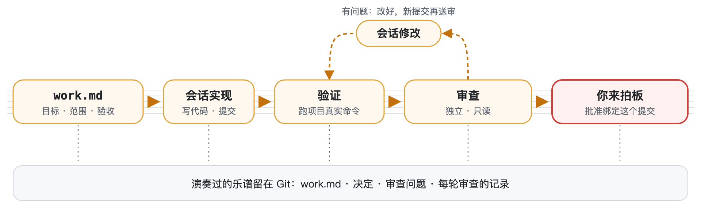
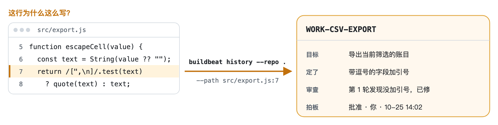

<p align="center">
  
</p>

<h1 align="center">BuildBeat</h1>

<h3 align="center">基于 Git 的项目上下文管理</h3>
<p align="center">每项需求为什么做、定了什么、做到哪，都跟代码一起存在 Git 里，<br>换会话、换工具、换人都能接着干。</p>

<p align="center">
  <a href="https://www.npmjs.com/package/@haiyangbg/buildbeat"></a>
  <a href="https://github.com/HaiYangBG1/BuildBeat/actions/workflows/ci.yml"></a>
  <a href="https://www.npmjs.com/package/@haiyangbg/buildbeat"></a>
  <a href="LICENSE"></a>
</p>

<p align="center">中文 · <a href="README.en.md">English</a></p>

用 AI 写代码，换个会话、换个软件、换台电脑、换个人，事情都得从头讲一遍。

BuildBeat 面向人和 AI 会话，把每项需求的来龙去脉记在项目和 Git 里，谁接手都能接着干。

## 一眼看懂

<picture>
  <source media="(max-width: 600px) and (prefers-color-scheme: dark)" srcset="https://raw.githubusercontent.com/HaiYangBG1/BuildBeat/main/docs/assets/readme/context-zh-dark-narrow.png">
  <source media="(max-width: 600px)" srcset="https://raw.githubusercontent.com/HaiYangBG1/BuildBeat/main/docs/assets/readme/context-zh-light-narrow.png">
  <source media="(prefers-color-scheme: dark)" srcset="https://raw.githubusercontent.com/HaiYangBG1/BuildBeat/main/docs/assets/readme/context-zh-dark.png">
  
</picture>

代码记录改了什么，工作记录写着为什么改、定了什么、做到哪。两样放在同一个仓库、同一段 Git 历史里，提交上带着工作编号，从哪头都能查到另一头。

## 解决什么问题

<table>
<tr>
<td>

### ① 换会话、换工具，接着干

会话越聊越长，AI 开始忘事；开个新会话、换个工具，又得从头讲一遍。BuildBeat 把每项需求的进度和决定写进项目文件，新会话读一遍，就从上次停下的地方接着干。一项工作放了几周再捡起来，如果里面提到的代码已经变了，也会提醒你。

<picture>
  <source media="(max-width: 600px) and (prefers-color-scheme: dark)" srcset="https://raw.githubusercontent.com/HaiYangBG1/BuildBeat/main/docs/assets/readme/handoff-zh-dark-narrow.png">
  <source media="(max-width: 600px)" srcset="https://raw.githubusercontent.com/HaiYangBG1/BuildBeat/main/docs/assets/readme/handoff-zh-light-narrow.png">
  <source media="(prefers-color-scheme: dark)" srcset="https://raw.githubusercontent.com/HaiYangBG1/BuildBeat/main/docs/assets/readme/handoff-zh-dark.png">
  
</picture>

</td>
</tr>
</table>

<table>
<tr>
<td>

### ② 上下文归项目，不归某个人

AI 工具自带的记忆，是围着人设计的：记在某个人的账号里、某台电脑上。同事接手你的模块时看不到这些，你离开项目，来龙去脉也跟着没了。BuildBeat 是围着项目重新设计的：上下文是项目的一部分，跟代码放在同一个 Git 仓库里，拉下代码就有；它跟代码一起进 PR 审查、一起留版本历史，用什么 AI 工具都能读。

<picture>
  <source media="(max-width: 600px) and (prefers-color-scheme: dark)" srcset="https://raw.githubusercontent.com/HaiYangBG1/BuildBeat/main/docs/assets/readme/owner-zh-dark-narrow.png">
  <source media="(max-width: 600px)" srcset="https://raw.githubusercontent.com/HaiYangBG1/BuildBeat/main/docs/assets/readme/owner-zh-light-narrow.png">
  <source media="(prefers-color-scheme: dark)" srcset="https://raw.githubusercontent.com/HaiYangBG1/BuildBeat/main/docs/assets/readme/owner-zh-dark.png">
  
</picture>

</td>
</tr>
</table>

<table>
<tr>
<td>

### ③ 记录是干活时顺手留下的

需求文档和决定记录，大家都知道该写，但没人有空写，写了也很快过时。在 BuildBeat 里，这些是干活时顺手留下的：AI 先写一份 work.md 给你看，你点头后，决定、测试结果和审查意见都会记下来，做完再留一份结论。这些文档别人读不读得懂也能试：让一个没看过任何上下文的只读 AI 只读这一份，看它读出了什么、哪里只能猜。

<picture>
  <source media="(max-width: 600px) and (prefers-color-scheme: dark)" srcset="https://raw.githubusercontent.com/HaiYangBG1/BuildBeat/main/docs/assets/readme/loop-zh-dark-narrow.png">
  <source media="(max-width: 600px)" srcset="https://raw.githubusercontent.com/HaiYangBG1/BuildBeat/main/docs/assets/readme/loop-zh-light-narrow.png">
  <source media="(prefers-color-scheme: dark)" srcset="https://raw.githubusercontent.com/HaiYangBG1/BuildBeat/main/docs/assets/readme/loop-zh-dark.png">
  
</picture>

</td>
</tr>
</table>

<table>
<tr>
<td>

### ④ 从一行代码查回需求

三个月后看到一段代码，没人记得当时为什么这么写，问 AI 它也只能猜。用 BuildBeat，指着这行代码就能查出它是为哪项需求写的、当时定了什么；也能按工单号查。

<picture>
  <source media="(max-width: 600px) and (prefers-color-scheme: dark)" srcset="https://raw.githubusercontent.com/HaiYangBG1/BuildBeat/main/docs/assets/readme/trace-zh-dark-narrow.png">
  <source media="(max-width: 600px)" srcset="https://raw.githubusercontent.com/HaiYangBG1/BuildBeat/main/docs/assets/readme/trace-zh-light-narrow.png">
  <source media="(prefers-color-scheme: dark)" srcset="https://raw.githubusercontent.com/HaiYangBG1/BuildBeat/main/docs/assets/readme/trace-zh-dark.png">
  
</picture>

</td>
</tr>
</table>

<table>
<tr>
<td>

### ⑤ 做没做完，看证据

AI 说「改好了，测试都过了」，你不敢全信，只能自己再跑一遍、再看一遍。AI 写完提交后，BuildBeat 自己在这个提交上跑项目的测试、读结果，再让另一个没参与写的只读 AI 审查；有问题，AI 改完再送一遍。最后停下来等你拍板，批准记在那个提交上，什么时候、谁同意的都有记录。

<picture>
  <source media="(max-width: 600px) and (prefers-color-scheme: dark)" srcset="https://raw.githubusercontent.com/HaiYangBG1/BuildBeat/main/docs/assets/readme/evidence-zh-dark-narrow.png">
  <source media="(max-width: 600px)" srcset="https://raw.githubusercontent.com/HaiYangBG1/BuildBeat/main/docs/assets/readme/evidence-zh-light-narrow.png">
  <source media="(prefers-color-scheme: dark)" srcset="https://raw.githubusercontent.com/HaiYangBG1/BuildBeat/main/docs/assets/readme/evidence-zh-dark.png">
  
</picture>

</td>
</tr>
</table>

> 从代码查需求、自己读测试结果、代码变了的提醒，需要装运行时。不装运行时、只让 AI 工具读项目文件，其余部分照样能用，见[只用 Skill 和项目文件](docs/guide/12-without-runtime.md)。

## 开始用

把下面这段复制给你的 AI 编程工具（Claude Code、Codex、Cursor 都行），它会自己装好、配好：

```
请帮我在这个项目里用上 BuildBeat（https://github.com/HaiYangBG1/BuildBeat）：

1. 检查本机有没有 Node 20 以上和 Git，缺了就告诉我怎么装。
2. 安装或升级 BuildBeat 运行时：
   npm view @haiyangbg/buildbeat@latest version
   npm install --global @haiyangbg/buildbeat@latest
   buildbeat --version
   如果本机装的是 6 以前的版本，并且还有没跑完的工作，先用旧版跑完或取消，再升级。
3. 读一遍 npm 包里的 SKILL.md 和 docs/guide/01-quickstart.md（在 $(npm root -g)/@haiyangbg/buildbeat/ 下），之后都按 SKILL.md 的方式干活。
4. 按快速开始把模板放进这个项目、补好 .gitignore。代码由你来写；审查默认用本机已登录的另一个 AI 命令行工具，拿不准就问我。
5. 弄好后用一两句话告诉我可以开始了。之后我只用平常的话跟你说要做什么，命令都由你来跑。
```

装好之后，就用平常的话跟它说，常见场景见下面「用起来是什么样」。

<details>
<summary>用 Claude Code？也可以装插件</summary>

```text
/plugin marketplace add HaiYangBG1/BuildBeat
/plugin install buildbeat@buildbeat-plugins
/buildbeat:buildbeat
```

</details>

想自己动手一步步装，见[快速开始](docs/guide/01-quickstart.md)。

不想装 Node 或运行时？只用 Skill 和项目文件也行，见[只用 Skill 和项目文件](docs/guide/12-without-runtime.md)。

## 用起来是什么样

| 场景 | 对话 |
| --- | --- |
| **第一次用** | **你**：（复制上面那段）<br>**AI**：装好了，可以开始了。 |
| **开始一项工作** | **你**：给账本加个导出 CSV 的功能。<br>**AI**：写好了 `work.md`：导出当前筛选的账目，带逗号的字段加引号，测试全过才算完。你看行吗？<br>**你**：行，开工。 |
| **换会话、换电脑、换人** | **你**：到哪了？<br>**AI**：「导出 CSV」做完了，等你拍板。第一轮审查发现带逗号没加引号，已经修好、重新测过，第二轮通过了。<br>**你**：批准，合并吧。 |
| **想再改改** | **你**：空表也要能导出。<br>**AI**：好，我改完提交，重新送去测、送去审，过了再叫你。 |
| **你自己动手改了** | **你**：按钮文案我改了，已经提交。<br>**AI**：看到了，我把你的提交送去测一遍、审一遍。 |
| **卡住了** | **AI**：停下来了：本地数据库没启动。这不是代码问题，我没改代码。<br>**你**：开好了，继续。 |
| **好几个仓库** | **你**：所有仓库到哪了？<br>**AI**：两个仓库一共三项工作：一项等你拍板，两项还在做。 |

它会停下来找你的情况只有这几种：工作说明要你确认、审完等你拍板、审查的问题要你裁决、环境出了问题。

<details>
<summary>「到哪了？」时 AI 背后看到的输出</summary>

```text
$ buildbeat status --repo . --work WORK-CSV-EXPORT
WORK-CSV-EXPORT  MERGE_DECISION
  [P1 0b5e258117cb5602] (open) csv: quote fields that contain commas
  work.md ✓ · runs 2 · unadjudicated P0/P1 findings 1
  cost: review rounds 2 · findings 1
  latest RUN-CSV-EXPORT-02 WAITING_HUMAN candidate f3db37d waiting enter-wait-merge
work WORK-CSV-EXPORT:
  RUN-CSV-EXPORT-02 [final-decision] enter-wait-merge — waiting 33s
    candidate: f3db37deac08fd6f00a4891af8067c92436bd9ea
    reason: verified and reviewed with no blocking finding; the decision on this commit is the person's
    next: buildbeat decide --repo . --work WORK-CSV-EXPORT --action approve --candidate f3db37d… --by <you>
    next: buildbeat decide --repo . --work WORK-CSV-EXPORT --action reject --reason <why> --by <you>
```

</details>

## 什么是一项工作

**是什么**：BuildBeat 记东西的最小单位。一个你能看到的结果，比如「导出 CSV」，就是一项工作，对应一个文件夹。

**为什么要有它**：AI 记不住事，会话也随时会换。把这件事要做什么、做到哪、审出过什么问题、你拍过什么板，都收进这个文件夹，谁接手都从这里接着干，回头也能翻出来看它是怎么做成的。

## 项目里的文件

第一次接入时，AI 会照模板把这些文件放好：

```
你的项目/
├── AGENTS.md、CLAUDE.md            告诉 AI 工具：这个项目用 BuildBeat
├── .gitignore                      加上下面两行 .buildbeat/ 目录
├── delivery/                       跟着 Git 走
│   ├── run-config.yaml             这个项目里一个提交怎么测、让谁审
│   ├── envelope/
│   │   ├── worker.sh               把审查用的 AI 工具包成 BuildBeat 能调用的一步
│   │   └── prompts/                审查和读者测试的提示词
│   └── work/
│       └── WORK-X/                 一项工作一个文件夹
│           ├── work.md             要做什么、做到什么算完
│           ├── run-config.yaml     可选：这项工作能改哪些目录、和项目不一样的配置
│           ├── decisions.jsonl     接受、批准、关闭这些决定
│           ├── review-findings.jsonl  审查挑出的问题和你的裁决
│           ├── reader-tests.jsonl  读者测试的记录（用到才有）
│           ├── releases.jsonl      上线后的检查记录（用到才有）
│           ├── result.md           关窗时写：做成了什么、剩下什么、写进了哪些项目文档
│           └── runs/RUN-X-01/
│               └── run-record.json 这一轮审查的结果、证据和成本
└── .buildbeat/
    ├── runtime/                    只在本机：每轮审查的台账、日志、截图
    └── worktrees/                  只在本机：送审时的临时检出，审完就删
```

- `delivery/` 进 Git：换会话、换软件、换电脑、换人，拉下代码就能接着干；不要在 `.gitignore` 或 `.git/info/exclude` 里排除它。里面的截图、压缩包和日志只留本机，不进 Git。工作文件夹只放这项工作的记录，外加它确实要用的少量文件（比如验证脚本）；命令输出、回读结果、一次性脚本不放进去，结论写进 `result.md`，以后还要用的脚本放进项目自己的目录。记录以外的文件超过 10 个时，`accept` 和 `check` 会提醒。
- `.buildbeat/runtime/`、`.buildbeat/worktrees/` 只在本机：还在等你拍板的那一轮不跟着 Git 走，换了机器重新送审一次
- 没装 BuildBeat 的人和 AI 也能读这些文件、起草 `work.md`

参与贡献看[贡献指南](CONTRIBUTING.md)，代码以 [MIT 许可证](LICENSE)开源。

> **名字的由来**：每一步是一个音符，Agent 按节拍把它们演奏出来；演奏过的乐谱——上下文、决定和结论——留在 Git 里，随时翻阅。
